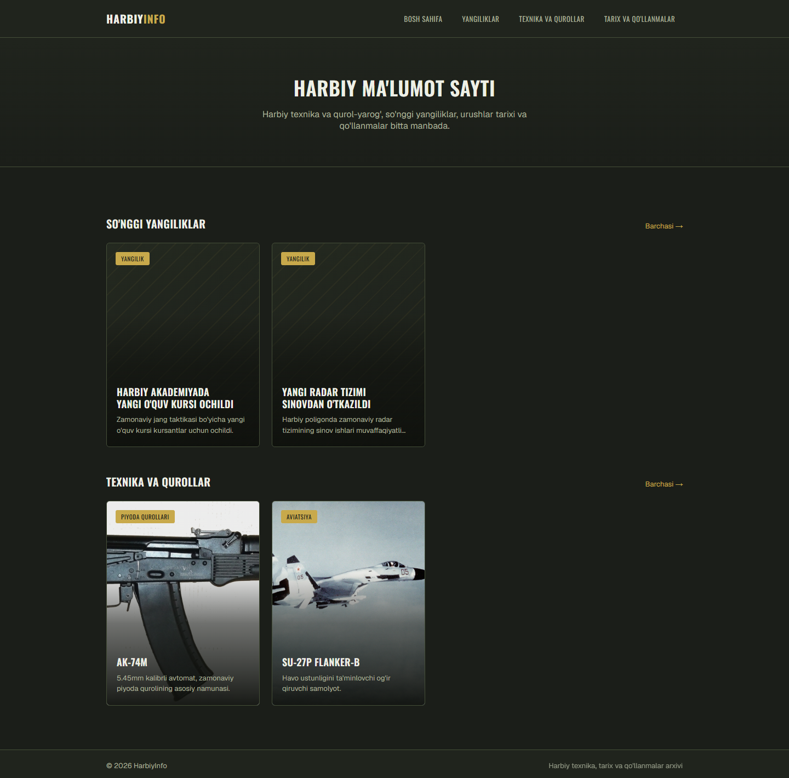
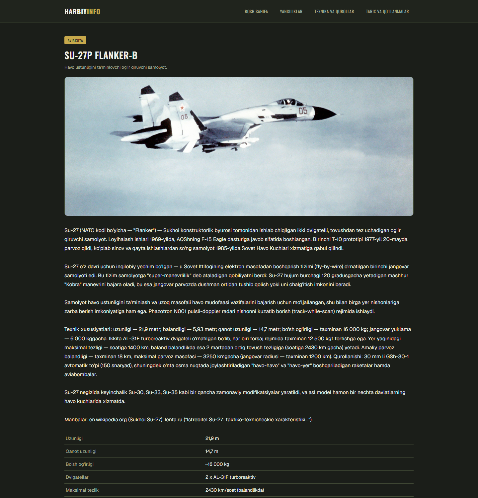
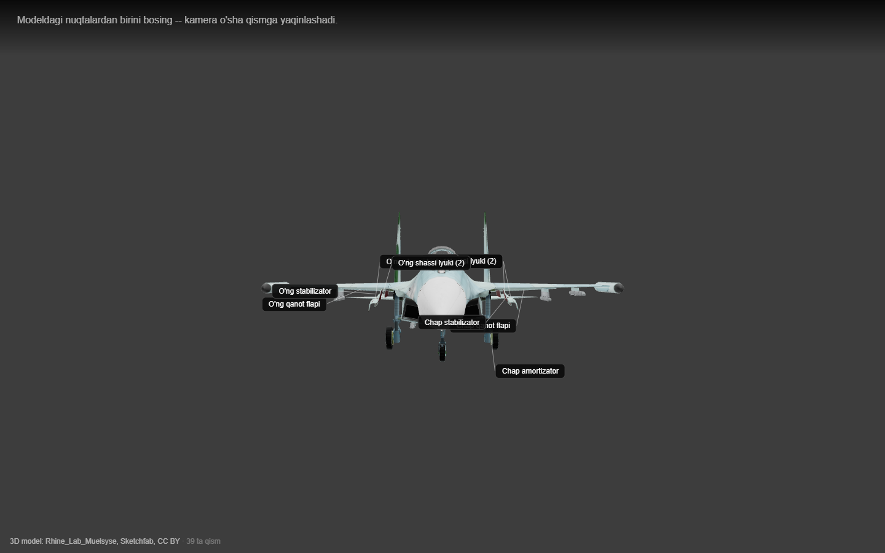
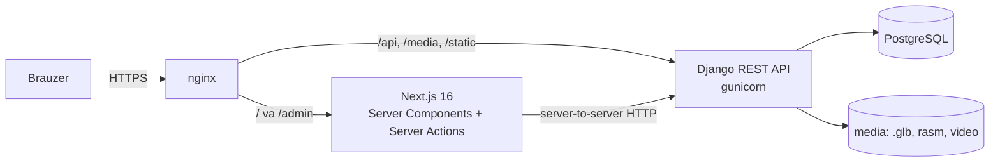

# HarbiyInfo — harbiy ma'lumot platformasi

Harbiy texnika va qurol-yarog' katalogi, yangiliklar, urushlar tarixi va qo'llanmalarni bitta joyda jamlagan veb-platforma. Asosiy xususiyati — texnikaning **interaktiv 3D "rentgen" ko'rinishi**: model brauzerda aylantiriladi, har bir qismi (dvigatel, shassi, qanot, avtomat qismlari) bosilganda kamera shu qismga yaqinlashib, o'zbekcha tavsifini ko'rsatadi.

**Jonli demo:** https://cineverse.uz

> Loyiha mustaqil ravishda, ochiq manbalardagi (Wikipedia, Wikimedia Commons) ma'lumotlar asosida yaratilgan. Kontentda manbalar har bir sahifada "Manbalar:" qatori bilan ko'rsatiladi. Maxfiy yoki cheklangan ma'lumot ishlatilmagan.

| Bosh sahifa | Texnika sahifasi | 3D ko'rinish |
| :---: | :---: | :---: |
|  |  |  |

## Imkoniyatlar

**Ommaviy sayt**
- Uch bo'lim: **Yangiliklar**, **Texnika va qurollar**, **Tarix va qo'llanmalar** (poster uslubidagi kartalar, kursor ustida yumshoq zoom animatsiyasi).
- Texnika sahifasida qisqa va to'liq tavsif, texnik xususiyatlar jadvali, rasm galereyasi, video (fayl yoki YouTube'ni sayt ichida ko'rsatish) va 3D ko'rinishga o'tish tugmasi.
- 3D "rentgen" ko'rinish (React Three Fiber / three.js): qismlarni tanlash, kameraning silliq yaqinlashishi, shaffof oyna (kabina) qismlari, qismlarga qo'yilgan yozuvlar (hotspot).

**Admin panel (CMS)** — `/admin`
- Yangiliklar, texnika, tarix/qo'llanmalarni qo'shish, tahrirlash, o'chirish; chop etish / qoralama holati.
- Har bir yozuvga muqova rasmi, ko'p rasm, video fayl yoki YouTube havolasi biriktirish.
- Texnik xususiyatlarni (kalibr, tezlik, ekipaj, …) erkin "nomi — qiymati" qatorlari sifatida boshqarish.
- **Yangi 3D modelni kod yozmasdan qo'shish**: `.glb` fayl yuklanadi, so'ng modelning o'zida (brauzerda) har bir qismni bosib nomi va tavsifi yoziladi. Dasturchi aralashuvi talab qilinmaydi.

## Arxitektura



- **Backend** — Django 6 + Django REST Framework. Ilovalar: `core` (umumiy media modeli, ruxsatlar, JWT), `articles` (yangilik/tarix/qo'llanma — bitta model, `section` maydoni bilan), `catalog` (texnika, kategoriyalar, 3D modellar va ularning qismlari).
- **Frontend** — Next.js 16 (App Router) + React 19 + TypeScript. Ommaviy sahifalar Server Component sifatida ma'lumotni Django'dan serverda oladi; brauzer Django bilan to'g'ridan-to'g'ri gaplashmaydi (3D model fayllaridan tashqari).
- **Ma'lumotlar bazasi** — PostgreSQL (lokal rivojlantirishda avtomatik SQLite).
- **Deploy** — Docker Compose: `db`, `web` (Django), `frontend` (Next.js), `nginx`, `certbot` (Let's Encrypt). Bitta domen ostida: `/api`, `/media`, `/static` → Django, qolgani → Next.js.

### Ma'lumotlar modeli

| Model | Vazifasi |
| --- | --- |
| `Article` | Yangilik / urushlar tarixi / qo'llanma (`section`), sarlavha, qisqa mazmun, matn, muqova, chop etish holati |
| `Equipment`, `Category`, `EquipmentSpec` | Texnika yozuvi, toifa va erkin shakldagi texnik xususiyat qatorlari |
| `Model3D`, `Model3DPart` | Yuklangan `.glb` fayl va uning har bir mesh'iga berilgan nom/tavsif |
| `MediaAsset` | Rasm / video fayl / YouTube — `ContentType` + `GenericForeignKey` orqali istalgan modelga biriktiriladi (`Article`, `Equipment`) |

## API

Ma'lumotni o'qish hamma uchun ochiq; yozish (POST/PATCH/DELETE) faqat xodim (`is_staff`) uchun. Chop etilmagan yozuvlar oddiy foydalanuvchiga ko'rinmaydi.

| Metod | Yo'l | Izoh |
| --- | --- | --- |
| `GET` | `/api/v1/articles/?section=news\|history\|manual` | Maqolalar ro'yxati; `/{slug}/` — bitta maqola |
| `GET` | `/api/v1/catalog/equipment/` | Texnika ro'yxati; `/{slug}/` — tavsif, xususiyatlar, media |
| `GET` | `/api/v1/catalog/models3d/{slug}/` | 3D model fayli va qismlarining yozuvlari |
| `POST` / `DELETE` | `…/{slug}/media/` | Rasm / video / YouTube biriktirish va o'chirish |
| `PUT` | `/api/v1/catalog/models3d/{slug}/parts/` | Model qismlari yozuvlarini bir so'rovda almashtirish |
| `POST` | `/api/v1/auth/login/`, `/auth/refresh/` | JWT olish / yangilash |

`DEBUG=True` bo'lganda interaktiv hujjat: `/api/docs/` (Swagger), `/api/redoc/`.

## Xavfsizlik

- **JWT tokenlar brauzer JavaScript'iga berilmaydi**: Next.js Server Action ularni `httpOnly` cookie'da saqlaydi (productionda `secure`, `SameSite=Lax`).
- Admin sahifalari serverda tekshiriladi (`requireAdminSession` — Next.js Data Access Layer namunasi): har so'rovda token Django'dagi `/auth/me/` orqali tasdiqlanadi va foydalanuvchi `is_staff` ekanligi tekshiriladi, aks holda `/admin/login`ga yo'naltiriladi.
- Tez-tez uchraydigan `/admin` yo'lini skaner qiluvchi botlardan himoya uchun admin yo'li oldida **nginx darajasidagi qo'shimcha parol** (HTTP Basic Auth) turadi.
- Production sozlamalari: HTTPS'ga majburiy yo'naltirish, HSTS, `SECURE_PROXY_SSL_HEADER`, CORS ro'yxati, login so'roviga IP bo'yicha chegara (soatiga 20 ta urinish).
- Maxfiy sozlamalar `.env` da; repoda faqat `.env.example` bor.

## Mahalliy ishga tushirish

Talablar: Python 3.12+, Node.js 22+.

**1. Backend**

```bash
python -m venv .venv
source .venv/bin/activate        # Windows: .venv\Scripts\activate
pip install -r requirements.txt

cp .env.example .env             # DJANGO_SECRET_KEY ni o'zgartiring
python manage.py migrate
python manage.py createsuperuser # admin panelga kirish uchun
python manage.py runserver 8000
```

**2. Frontend** (boshqa terminalda)

```bash
cd frontend-next
npm ci
npm run dev                      # http://localhost:3000
```

Frontend Django manzilini `DJANGO_API_BASE_URL` o'zgaruvchisidan oladi (standart: `http://127.0.0.1:8000`).

Keyin: `http://localhost:3000/admin/login` ga superuser bilan kiring → **Texnika** bo'limida yozuv yarating. 3D ko'rinish uchun: **3D modellar → Yangi model** (`.glb` yuklang) → modelda qismlarni bosib nom/tavsif yozing → texnika yozuvida shu modelni tanlang.

## Production'ga joylash (Docker Compose)

```bash
cp .env.example .env                                  # DJANGO_SECRET_KEY, POSTGRES_PASSWORD, MEDIA_URL, DJANGO_DEBUG=False, ...
htpasswd -c .htpasswd_admin <login>                   # yoki: printf "<login>:$(openssl passwd -apr1)\n" > .htpasswd_admin
docker compose up -d --build
```

`nginx.conf` dagi `server_name` va sertifikat yo'llarini o'z domeningizga moslang (sertifikat `certbot` bilan olinadi).

## Muhandislik qarorlari

Loyiha ustida ishlash jarayonida hal qilingan, e'tiborga loyiq masalalar:

- **Server-to-server so'rovlar `fetch()` emas, `http` moduli orqali.** Productionda Node'ning o'rnatilgan `fetch()` funksiyasi qo'shni Docker konteyner (Django) bilan ulanishda muddatsiz osilib qolishi aniqlandi (oddiy `http.request` esa bir zumda ishlaydi). Sababi oxirigacha aniqlanmadi, shuning uchun `frontend-next/lib/internal-fetch.ts` yozildi — `multipart/form-data` (fayl yuklash) ni ham o'zi quradigan kichik mijoz.
- **Ommaviy sahifalar har so'rovda dinamik render qilinadi (`force-dynamic`).** `next build` Docker build bosqichida Django'ga ulana olmaydi, shuning uchun statik "snapshot" bo'sh ma'lumot bilan qotib qolar va har deploy'dan keyin sayt bir muddat bo'sh ko'rinar edi.
- **Rate limit faqat login'ga.** Dastlab butun API uchun umumiy anonim chegara (soatiga 200 so'rov) qo'yilgan edi. Lekin Next.js barcha tashrifchilar nomidan Django'ga bitta konteyner IP'sidan murojaat qiladi va botlar tasodifiy URL'larni skaner qiladi — chegara tez to'lib, sayt ma'lumotlari bo'sh chiqa boshladi (loglarda yuzlab `429`). Endi faqat brute-force'ga ochiq login uchun `ScopedRateThrottle` ishlatiladi, mijoz IP'si `NUM_PROXIES=1` bilan nginx qo'shgan `X-Forwarded-For`dan olinadi.
- **Absolut `MEDIA_URL`.** DRF fayl URL'ini joriy so'rovning `Host` sarlavhasidan quradi; server-to-server so'rovda bu ichki konteyner nomi (`web:8000`) bo'lib, brauzerga yetib bormasdi. Production'da `MEDIA_URL` to'liq domen sifatida beriladi.
- **3D modellar kodda emas, ma'lumotlar bazasida.** Dastlab har bir model TypeScript fayllarida qattiq yozilgan edi; endi `Model3D` / `Model3DPart` jadvallari va admin ichidagi qismlarga yozuv qo'yish vositasi orqali yangi model qo'shish dasturchisiz mumkin.
- **Umumiy media modeli.** `MediaAsset` `GenericForeignKey` orqali ishlagani uchun rasm/video/YouTube biriktirish mantig'i (`core/mixins.py`) bir marta yozilib, yangilik va texnikada qayta ishlatiladi.

## Loyiha tuzilmasi

```
.
├── config/            # Django sozlamalari, URL'lar
├── core/              # MediaAsset, JWT /me, ruxsatlar, media mixin
├── articles/          # Yangilik / tarix / qo'llanma
├── catalog/           # Texnika, kategoriya, 3D model va qismlari
├── frontend-next/
│   ├── app/(site)/    # Ommaviy sahifalar
│   ├── app/admin/     # CMS (login + himoyalangan bo'limlar)
│   ├── app/[slug]/    # 3D ko'rish sahifasi
│   ├── components/    # Viewer, InteractiveModel, PosterCard, admin formalari
│   └── lib/           # API mijozlari, internal-fetch, admin session/actions
├── docker-compose.yml
├── nginx.conf
└── Dockerfile
```

## Mualliflik va litsenziyalar

- Muallif: [@nursultonqadamov](https://github.com/nursultonqadamov)
- 3D modellar (Sketchfab, **CC BY**): *Su-27* — Rhine_Lab_Muelsyse; *AK-74M* — FJH. Mualliflik izohi saytning 3D sahifasida ham ko'rsatiladi. Model fayllari repoga kiritilmagan.
- Texnika rasmlari — Wikimedia Commons (har biri o'z ochiq litsenziyasi bilan); repoga kiritilmagan.
- Matnlar o'zbek tilida original yozilgan, asosiy manbalar: Wikipedia va ochiq ommaviy axborot manbalari.

---

<details>
<summary><b>English summary</b></summary>

**HarbiyInfo** is a full-stack military-information platform (Uzbek-language UI): an equipment & weapons catalog, news, and war-history/manuals sections, built around an **interactive 3D "x-ray" viewer** — click any part of a model (e.g. a Su-27 fighter or an AK-74M rifle) and the camera zooms in and shows its description.

- **Backend:** Django 6 + Django REST Framework, JWT auth, PostgreSQL, a generic `MediaAsset` model (image / video / YouTube) via `GenericForeignKey`.
- **Frontend:** Next.js 16 (App Router, Server Components, Server Actions) + React 19 + TypeScript + React Three Fiber / three.js.
- **Admin CMS:** full CRUD for all sections, media management, and a no-code workflow to add new 3D models (upload `.glb`, then label its parts in the browser).
- **Ops:** Docker Compose (nginx, Let's Encrypt, Django, Next.js, Postgres); httpOnly-cookie sessions; extra nginx-level auth in front of the admin area.
- **Live demo:** https://cineverse.uz

See the Uzbek sections above for architecture, API, security notes, local setup, and engineering decisions (custom `http`-based server-to-server client, build-time snapshot pitfalls, absolute `MEDIA_URL`, DB-driven 3D models).

</details>
